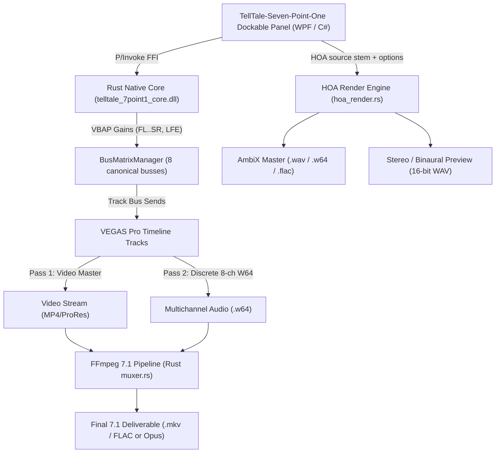

# TellTale-Seven-Point-One

**Experimental 7.1 surround, HOA / 3D spatial audio, and stem-export extension for MAGIX / Boris FX VEGAS Pro.**


> [!WARNING]
> **EXPERIMENTAL / BETA SOFTWARE.** This project is under active development. Its APIs, state files, file formats, UI, and exports may change without notice. It is not production-hardened and has not been validated for client-critical or broadcast delivery. Work on copies of your projects, keep backups, and verify every export before relying on it.

**TellTale-Seven-Point-One** creates discrete 7.1 mixes, exports uncompressed Wave64 masters with optional FLAC, Opus, Vorbis, WavPack, or LPCM delivery through the user's own FFmpeg installation, and renders ACN/SN3D AmbiX masters plus binaural/stereo previews.

## Project status: Experimental

- **Beta software:** interfaces, persistence, and export behavior can change between builds.
- **Not a calibrated mastering tool:** the built-in HOA preview is a compact stereo/binaural monitoring aid, not a calibrated room or HRTF reference.
- **Verify before delivery:** check 7.1 bussing, channel order, and AmbiX playback in your own VEGAS project and decoder/monitoring chain.
- **Current focus:** real-world feedback on bus routing, MKV compatibility, and HOA preview/monitoring workflows.

### Naming

The public product, repository, release, menu, and panel name is **TellTale-Seven-Point-One**. These technical identifiers intentionally retain legacy names so VEGAS can load the extension and existing projects keep their state:

- Managed panel: `TellTale7PointOne.dll`
- Native core: `telltale_7point1_core.dll`
- C# namespace / project: `VegasSurround71`
- Per-user state: `%LOCALAPPDATA%\TellTale7PointOne\`
- Build override: `TELLTALE_71_DISPLAY_NAME`

---

## 1. Executive Summary & Core Innovation

VEGAS Pro natively caps its Surround Master Bus at **5.1** (FL, FR, FC, LFE, SL, SR). Modern desktop, web delivery, and archival workflows can use discrete **7.1 surround** (adding Left Surround / Right Surround alongside Back Left / Back Right), and immersive/spatialized beds require even more channels.

**TellTale-Seven-Point-One** bypasses VEGAS Pro's 5.1 master limitation entirely by combining:
1. **A Native C# Dockable Panel (`ScriptPortal.Vegas`)**: A high-performance WPF UI (`ElementHost` with modeless keyboard interop) featuring a 2D overhead soundstage canvas, draggable audio pucks, live 8-channel meters, and timeline keyframe automation.
2. **An Automated 8-Bus Routing Topology**: Dynamic provisioning of 8 discrete VEGAS audio busses mapped to `[7.1] FL, FR, FC, LFE, BL, BR, SL, SR`, exporting lossless 8-channel discrete Wave64 (`.w64`) audio.
3. **A High-Performance Native Rust Core (`telltale_7point1_core.dll`)**: A zero-overhead C-ABI DLL implementing 2D Vector Base Amplitude Panning (VBAP), 4th-order Linkwitz-Riley 120 Hz LFE low-pass filtering, SMPTE channel mask ordering, automated FFmpeg master muxing using open/royalty-free codecs, and an ACN/SN3D HOA render/preview engine.
4. **An HOA / 3D Spatial Workspace**: A Resolve-style workspace switcher, 3D soundstage, 1st/2nd/3rd-order AmbiX render, distance/air/head-model/room effects, source presets, snap, A/B, metering, and per-project recall — kept completely separate from the 7.1 bus routing.



---

## 2. Channel Order & Specification Standards

Discrete 8-channel assignments adhere to standard ITU-R BS.775 / SMPTE 7.1 configurations:

| Index | Channel Name | Abbreviation | ITU-R BS.775 Angle | Bus Name in VEGAS | SMPTE Channel # |
| :---: | :--- | :---: | :---: | :--- | :---: |
| **0** | Front Left | `FL` | $-30^\circ$ | `[7.1] FL` | 1 |
| **1** | Front Right | `FR` | $+30^\circ$ | `[7.1] FR` | 2 |
| **2** | Front Center | `FC` | $0^\circ$ | `[7.1] FC` | 3 |
| **3** | Low Frequency Effects | `LFE` | Subwoofer | `[7.1] LFE` | 4 |
| **4** | Back Left (Rear) | `BL` | $-150^\circ$ ($210^\circ$) | `[7.1] BL` | 5 |
| **5** | Back Right (Rear) | `BR` | $+150^\circ$ | `[7.1] BR` | 6 |
| **6** | Side Left | `SL` | $-90^\circ$ ($270^\circ$) | `[7.1] SL` | 7 |
| **7** | Side Right | `SR` | $+90^\circ$ | `[7.1] SR` | 8 |

### Delivery compatibility

| Preset | Codec | Notes |
| :--- | :--- | :--- |
| **FLAC 7.1 MKV** | FLAC lossless | Default/master archive; broad MKV support |
| **Opus 7.1 MKV** | Opus 768 kbps | Compact/modern; test multichannel playback in the target player |
| **Vorbis 7.1 MKV** | Vorbis q8 | Mature patent-free lossy option; legacy playback support |
| **WavPack 7.1 MKV** | WavPack lossless | Lossless; less common in consumer players |
| **LPCM 24-bit 7.1 MKV** | PCM s24le | Uncompressed; large files, broad editor support |

Example outputs:

```text
movie_7.1_flac.mkv
movie_7.1_opus.mkv
movie_7.1_vorbis.mkv
movie_7.1_wavpack.mkv
movie_7.1_lpcm.mkv
```

The extension's 3-pass pipeline produces `.mkv` directly. VEGAS itself can also render the discrete 8-channel Wave64 master (e.g. `movie_7.1_master.w64`); the extension deletes its temporary `.w64` stem after muxing.

### Not implemented (and why)

- **IAMF / Eclipsa Audio:** IAMF is a royalty-free spatial container, but the installed FFmpeg has only a raw IAMF muxer and rejects 7.1 input. Supporting IAMF/7.1.4 objects would require a separate IAMF encoder/metadata pipeline and an audio-only export path.
- **IAMF / Eclipsa:** remains planned for Phase D. The current HOA workspace exports AmbiX WAV/W64/FLAC and renders stereo/binaural previews; it does not produce IAMF objects.
- **Ambisonics playback support:** AmbiX files are written as plain ACN/SN3D multichannel PCM with no standard speaker mask. Consumer players need their own AmbiX decoder; the panel's preview is a purpose-built stereo/binaural monitor, not a room-calibrated renderer.
- **WavPack hybrid mode:** WavPack is delivered as lossless only; hybrid mode requires a separate correction file, which the single-MKV pipeline cannot carry.
- **ALAC:** FFmpeg's ALAC encoder supports `7.1(wide)` and 6.1, not standard `7.1`; using it would misroute channels, so it is intentionally not offered.

---

## 3. Architecture & Repository Layout

```text
TellTale-Seven-Point-One/
├── README.md                   # Complete architectural guide & documentation
├── LICENSE                     # Apache License 2.0
├── NOTICE                      # Attribution notice
├── THIRD_PARTY_NOTICES.md      # FFmpeg, VEGAS SDK, codec and platform notes
├── deploy/                     # Installer script; DLLs are built locally and ignored
├── rust_core/                  # Rust cdylib crate (vegas_surround71_core)
│   ├── Cargo.toml              # cdylib + rlib configuration (release panic = unwind)
│   ├── src/
│       ├── lib.rs              # C-ABI exports (calculate_71_gains, mux_71_master, HOA)
│       ├── vbap.rs             # 2D 7.1 VBAP math, power normalization & LFE proximity
│       ├── dsp.rs              # 4th-order Linkwitz-Riley LFE filter & W64 channel remapper
│       ├── hoa.rs              # ACN/SN3D HOA weights (1st/2nd/3rd order)
│       ├── hoa_render.rs       # HOA WAV/W64/FLAC master + stereo/binaural preview
│       └── muxer.rs            # FFmpeg CLI worker pipeline (W64 + Video -> 7.1 master)
│   └── tests/
│       └── channel_roundtrip.rs # End-to-end 8-channel identity & LFE DFT verification
├── tools/
│   ├── HostProbe/              # In-host probe (validation, panel, live-pan, HOA smoke)
│   └── Phase4BVerification/    # 221-check offline/ABI/HOA/state/render tests
├── tutorials/
│   └── opengl_hoa/             # Self-contained WebGL 2 HOA / 3D Spatial tutorial
│       ├── index.html          # Chapter UI + OpenGL scene canvas
│       ├── style.css           # Dark studio theme
│       ├── app.js              # Scene, SH/VBAP/monitor math, audition
│       └── README.md           # Run instructions, chapter map, fidelity notes
└── vegas_panel/                # C# .NET Framework 4.8 WPF Class Library (x64)
    ├── VegasSurround71.csproj  # net48, x64, TellTale7PointOne assembly, stages deploy/
    ├── NativeBridge.cs         # P/Invoke + UTF-8 path marshaling + MUX_ERR_* codes
    ├── BusMatrixManager.cs     # 8-bus provisioning & real BusX send automation
    ├── HostScriptBridge.cs     # Script-host mutation/undo bridge + root-cause unwrap
    ├── HostValidation.cs       # Phase 4A in-host topology/automation validation
    ├── DeliveryPresets.cs      # Royalty-free MKV presets + video-family compatibility
    ├── ExtensionSettings.cs    # Display name precedence + legacy settings migration
    ├── RenderPlan.cs           # Render/loop-region validation, codec rules, temp stems
    ├── RenderOrchestrator.cs   # Video template catalog + 3-pass render/mux
    ├── HoaRenderOrchestrator.cs # HOA stem render + AmbiX encode/preview
    ├── ExtensionModule.cs      # ICustomCommandModule & dockable host lifecycle
    ├── AbiVerification/        # Standalone 69-check ABI/layout verification
    └── UI/
        ├── HostPanel.cs        # DockableControl + ElementHost wrapper
        ├── WorkspaceShellView.xaml/.cs # Segmented 7.1 / HOA workspace shell
        ├── SurroundPanelView.xaml/.cs # Studio NLE soundstage, meters, export
        ├── HoaSpatialView.xaml/.cs    # 3D soundstage, HOA order/preview/export
        ├── WorkspaceContext.cs # Shared project, track, playhead, loop, log
        ├── Surround71State.cs  # Isolated 7.1 panner state
        ├── HoaSpatialState.cs  # Isolated HOA state + 3D soundstage math
        ├── HoaProjectStateStore.cs # Per-project HOA recall (atomic sidecar)
        └── SoundstageMath.cs   # Pure speaker/meter/screen math
```

### Interactive OpenGL tutorial

`tutorials/opengl_hoa/` is a self-contained WebGL 2 (OpenGL ES 3.0) explainer for the HOA / 3D Spatial workspace. Open `tutorials/opengl_hoa/index.html` directly in a browser; there is no build step and no network access.

| Chapter | Concept | Mirrors |
| :---: | :--- | :--- |
| 01 | Azimuth, elevation, distance and world axes | `hoa.rs::unit_vector` |
| 02 | W/Y/X equal-power stereo downmix | `hoa_render.rs::decode_stereo` |
| 03 | 7.1 speaker ring, VBAP pair search and inversion | `vbap.rs` |
| 04 | ACN/SN3D orders 1–3, SH balloon and heatmap | `hoa.rs::fill_weights`, `apply_spread_and_distance` |
| 05 | ITD, ILD/head shadow, rear tilt | `hoa_render.rs::decode_binaural` |
| 06 | Distance models and air absorption | `distance_model_factor`, `apply_air_absorption` |
| 07 | Stem → HOA → AmbiX master or preview | `HoaRenderOrchestrator.cs`, `NativeBridge.cs` |

The tutorial is a teaching visualizer. It does not load the extension, edit a project, or route audio through the `[7.1] FL..SR` buses. See `tutorials/opengl_hoa/README.md` for controls, fidelity notes and verification.

---

## 4. Technical Specifications & Dependencies

* **Target Application:** Boris FX VEGAS Pro 2027 / MAGIX VEGAS Pro 21/22.
* **VEGAS SDK Assembly:** `ScriptPortal.Vegas.dll` (`net48`, `x64`).
* **Rust Toolchain:** Rust 1.80+ (MSVC `x86_64-pc-windows-msvc`).
* **C-ABI Export:** `telltale_7point1_core.dll` (`#[repr(C)]` layout, Cdecl calling convention).
* **Target Framework (Panel):** `.NET Framework 4.8` (`x64`).
* **UI Stack:** WPF `UserControl` hosted in a VEGAS `DockableControl` through `ElementHost`.
* **Deployment:** `deploy/` is staged automatically; live install target is `Documents\Vegas Application Extensions\` with the panel DLL + native core side-by-side.
* **External Tooling:** FFmpeg must be installed separately by the user and available on the system `PATH`. This extension does not bundle, distribute, or license FFmpeg or any third-party audio/video codec.

### FFmpeg requirement

The extension does **not** ship FFmpeg, and VEGAS Pro 2027 does not provide one. Pass 3 launches the `ffmpeg` executable found on the host OS `PATH`.

1. Install an FFmpeg build whose license you can comply with.
2. Add its `bin` folder to the Windows `PATH`.
3. Verify in a terminal:

   ```powershell
   ffmpeg -version
   ```

If FFmpeg is missing, Pass 1 (video) and Pass 2 (Wave64) can still finish, but Pass 3 fails with `MUX_ERR_FFMPEG` (`-3`). The panel reports a message telling you to install FFmpeg and put `ffmpeg.exe` on `PATH`.

FFmpeg is free/open-source software, but “free” does not mean free of all licensing or patent considerations. FFmpeg builds can be LGPL or GPL, and may contain patent-encumbered codecs. This extension invokes only the FLAC and Opus encoders; you are responsible for the FFmpeg build you install and for complying with its license and any applicable patent terms. This is not legal advice.

---

## 5. Development & Phased Implementation Status

This project is governed by strict sequential phase execution:

* **[x] PHASE 1: Rust Spatial VBAP Engine & C-ABI FFI Core**
  * Implemented standard ITU-R BS.775 7.1 speaker angles.
  * Formulated 2D adjacent speaker pair matrix inversion ($g = p^T L_{12}^{-1}$).
  * Ensured constant energy conservation ($\sum_{sat} g_i^2 = 1.0$) across arbitrary 2D room coordinates.
  * Implemented radial listener proximity LFE boost and manual send scaling.
  * Exported `ChannelGains71` (32-byte `#[repr(C)]`) and `calculate_71_gains` via C-ABI.
  * Verification: 6 unit tests passing, `telltale_7point1_core.dll` built cleanly in Release.

* **[x] PHASE 2: Rust W64 Channel Remapper & FFmpeg 7.1 Muxer** — **COMPLETE & VERIFIED**
  * 4th-order Linkwitz-Riley 120 Hz LFE low-pass (`lowpass=f=120:poles=2` × 2) applied exclusively to `c3`.
  * Explicit `pan=7.1|FL=c0|FR=c1|FC=c2|LFE=c3|BL=c4|BR=c5|SL=c6|SR=c7` channel mapping for Wave64 exports (no reliance on container metadata).
  * `mux_71_master` C-ABI export with full `catch_unwind` panic containment and `CREATE_NO_WINDOW` FFmpeg spawning.
  * **Open, royalty-free audio codecs only:** the muxer accepts FLAC, Opus (`-mapping_family 1`, 768 kbps), Vorbis (`-q:a 8`), WavPack (lossless), and LPCM 24-bit. AAC, E-AC-3 and other patent-encumbered delivery paths were removed. FLAC/Opus/Vorbis/WavPack/LPCM are open, royalty-free codec technologies; the extension does not bundle FFmpeg, and users must ensure their own FFmpeg build, license, and intended use comply with applicable terms.
  * **Atomic delivery:** FFmpeg writes `<stem>.tmp.<ext>`; the file is renamed onto the requested output only on exit code `0` and deleted on any failure.
  * Verification: 29 tests passing (27 unit + 2 FFmpeg round-trip; includes the 6 Phase 1 VBAP tests); PE x64 export table contains both `calculate_71_gains` and `mux_71_master`.

* **[x] PHASE 3: C# VEGAS Pro Host Bridge & Automated 8-Bus Scaffolding** — **COMPLETE & VERIFIED**
  * `VegasSurround71.csproj`: net48, x64, `ScriptPortal.Vegas` referenced with `<Private>false</Private>` from the local VEGAS Pro 2027 installation.
  * `NativeBridge.cs`: 32-byte `ChannelGains71`, `AudioCodec71`, all `MUX_ERR_*` constants, panic-safe P/Invoke declarations, and NUL-terminated UTF-8 byte-array path marshaling (Unicode-safe).
  * `BusMatrixManager.cs`: idempotent provisioning of `[7.1] FL` … `[7.1] SR` inside a single `UndoBlock`, `MonoRenderEnabled` + `MonoRenderOrder = 0..7`, and VBAP gain application through each bus's real `EnvelopeType.BusX` send envelope (keyframed or static).
  * Verification: `dotnet build -c Release` → 0 warnings / 0 errors; 35/35 ABI checks passed (32-byte layout, field offsets, UTF-8 round-trip, native DLL load and status codes).
  * **SDK adaptation:** `ScriptPortal.Vegas` 2027 has no `BusMode.Busses`, `MinimumBusCount`, `TrackSend`, or `EnvelopeType.BusSend`. Assignable busses are `AudioBusTrack`s, their mutable label is `Description` (`Name` is read-only), and a send is the bus's real `EnvelopeType.BusX` envelope. The implementation maps the Phase 3 contract onto those real APIs.

* **[x] PHASE 4: Dockable WPF Soundstage, Live Meters & One-Click 7.1 Render** — **IMPLEMENTED & VERIFIED (full render smoke pending media)**
  * **Phase 4A PASSED (documented envelope-undo limitation):** dockable host, native status, 8-bus provisioning, real bus-letter send mapping (`BusC..BusJ`), repeatability, mono render mapping, and automation writes verified in-host (108/111 checks; envelope automation undo is a VEGAS 2027 host limitation).
  * **Phase 4B:** WPF 2D soundstage with draggable puck, live 8-channel gain meters (`FL · Front L` … `SR · Side R`), 1-based track selector (`Track 1`, `Track 1 - <Name>`), LFE/Spread sliders, keyframe toggle, local panel undo/reset, and an **Export 7.1 Master** section.
  * **Configurable extension name:** `ExtensionSettings` resolves the panel/menu name from `TELLTALE_71_DISPLAY_NAME`, `%LOCALAPPDATA%\TellTale7PointOne\settings.json`, the MSBuild `ExtensionDisplayName` metadata, then `TellTale-Seven-Point-One`. The managed and native DLLs are named `TellTale7PointOne.dll` and `telltale_7point1_core.dll`; the exported C ABI is unchanged.
  * **Loop-region export:** **Render Loop Region Only (In / Out)** sends the same `Transport.LoopRegionStart`/`LoopRegionLength` to both Pass 1 video and Pass 2 Wave64, so the stems align frame-accurately. Missing In/Out points disable export with `Set In/Out loop points on the VEGAS timeline first.`
  * **Studio UI:** dark NLE-styled header with bus-status pills, radar soundstage with concentric rings, dynamic spread halo, gain-driven speaker glow, custom dark controls, segmented green-to-amber meters, and a 28 px status footer with an expandable diagnostic drawer.
  * **Track actions:** **Apply to Track** commits the current state; **Reset Puck Position** returns the puck to its initial position without writing; **Reset Track Keyframes** clears 7.1 send automation on the selected track (confirmed warning); **Reset All** restores panel defaults and clears all 7.1 send automation (confirmed warning).
  * **Uninitialized-bus guard:** if the busses are missing, pan commits are blocked with `Click 'Setup 7.1 Busses' to route tracks first.` instead of surfacing a reflection wrapper exception.
  * **Project-transition safety:** `ProjectOpened`/`ProjectClosed` reset the panel, clear stale track/template/pending/undo state, and re-detect project identity before actions. Panel diagnostics are mirrored to `%LOCALAPPDATA%\TellTale7PointOne\panel.log`.
  * **Diagnostic transcript:** the panel log is labeled **TellTale-Seven-Point-One Diagnostic**; the Tools diagnostic writes `%LOCALAPPDATA%\TellTale7PointOne\TellTale-Seven-Point-One Diagnostic.txt`.
  * **3-pass render orchestrator:** project-matched video stem → mapped 8-channel Wave64 stem → native FFmpeg mux/encode; temp stems are always cleaned up and the final file is published atomically.
  * **Deployment:** the panel build stages `TellTale7PointOne.dll` + `telltale_7point1_core.dll` into `deploy/`.
  * **Send-level fix:** VEGAS 2027 bus-send envelopes (`BusX`) are linear **0..2** with neutral 1.0, not dB. The mapper now writes linear gains and the bridge logs post-write read-back values (`FL(Bus A)=0.8423/-1.5dB …`). The installed SDK has no `TrackSend`/`Send.Level`; the envelope is the supported send path.
  * **Live mixer panning (no transport stop):** each puck/slider movement writes the eight `BusX` send envelopes **directly from the extension UI thread** at ~30 Hz inside one `UndoBlock`. Unlike `RunScriptText`, this does not stop the transport, so audio and the VEGAS Mixing Console bus meters follow the puck in real time during playback. A **Live Mixer Sync** checkbox (default on) disables it if desired; if a direct write fails, the panel automatically falls back to the safe deferred queue. Static mode keeps a time-zero anchor while collapsing later points, and keyframe mode writes at the live play cursor.
  * **Playback-safe fallback queue:** with **Live Mixer Sync** off (or if a live write fails), dragging only updates the native meters and queues samples (10 Hz keyframes or latest static). A dispatcher timer flushes one batch when playback stops.
  * **Bus FX shortcut:** gain-meter channel labels are clickable (`Open VEGAS FX Chain for [7.1] <CH>`); the installed SDK lacks `OpenEffectsDialog`, so the view uses a reflection hook for future builds and otherwise opens the Mixing Console for the Bus FX button.
  * **Renderer/template + delivery presets:** choose a video renderer/template (`AVC`, `HEVC`, `ProRes`, `AV1`, `XAVC`, etc.) and a delivery preset: **FLAC 7.1 MKV** (lossless default), **Opus 7.1 MKV** (compact/modern, 768 kbps), **Vorbis 7.1 MKV**, **WavPack 7.1 MKV**, or **LPCM 24-bit 7.1 MKV**. Changing the preset/codec auto-syncs the output extension. Compatibility varies by codec; test the target player. The app does not independently encode AAC or E-AC-3.
  * **Startup safety:** `HostValidation` and undo probes only run when `VEGAS_SURROUND71_RUN_VALIDATION=1`; normal launches never create `[TEST]` tracks or validation dialogs.
  * Verification: `cargo build --release` exit 0; panel build 0 warnings/0 errors; 35/35 ABI checks; 140/140 Phase 4B/4C checks; WPF panel loaded and interacted in VEGAS Pro 2027 (busses setup, puck drag committed); in-host live-pan probe wrote all 8 sends during active playback without stopping the transport.
  * Note: stock VEGAS 2027 Wave64 templates top out at 6 channels; the orchestrator prefers a user-created 8-channel template and otherwise uses `UseChannelMapping` with the 5.1/6-channel template. A full render smoke test with media remains the final manual checklist item.

* **[x] PHASE 5: Resolve-Style Workspace Switcher & HOA / 3D Spatial Scaffolding** — **IMPLEMENTED & VERIFIED**
  * **Workspace shell:** `WorkspaceShellView` hosts a segmented `7.1 Panner` / `HOA / 3D Spatial` switcher in a Studio NLE header. Both workspace views are created once and cached; switching toggles visibility only, so it never resets a puck, rewrites a bus send, or clears automation.
  * **Shared context, isolated state:** `WorkspaceContext` carries the selected track, playhead, In/Out loop region, project identity, and diagnostics logger. `Surround71State` and `HoaSpatialState` remain strictly separate; the HOA code contains no `BusMatrixManager`, `EnvelopeType`, or `ApplyTrackPanning` reference.
  * **HOA / 3D Spatial workspace:** overhead radar plus an elevation rail, draggable source puck, azimuth (`-180°..+180°`), elevation (`-90°..+90°`), distance (`0..1`), spread, live numeric readouts, the `1st Order (4 ch)` / `2nd Order (9 ch)` / `3rd Order (16 ch)` selector, `Binaural (Headphones)` / `Stereo Downmix` preview selector, `HOA AmbiX WAV` / `HOA AmbiX Wave64` / `HOA AmbiX FLAC` / `IAMF / Eclipsa (Planned)` export choices, a context-synced track selector, and **Reset 3D Position**.
  * **Native HOA scaffolding:** `rust_core/src/hoa.rs` adds the `#[repr(C)]` 20-byte `HoaSourcePosition`, `hoa_channel_count`, and `calculate_hoa_weights` (ACN/SN3D, `catch_unwind` panic containment). Existing 7.1 exports are untouched.
  * **In-host hardening:** video tracks are excluded from both selectors and labels use the real VEGAS track number. `WorkspaceContext` caches only track index/name (never a COM wrapper), `HostPanel` refreshes both selectors on `TrackCountChanged` with a track-count fallback, and pending pan batches are discarded instead of writing to a shifted track. The HOA log drawer is readable on dark and the header reports `AMBIX RENDER READY` (Phase C).
  * Verification: `cargo test` 55/55 unit tests + 2/2 FFmpeg round-trip tests; panel build 0 warnings / 0 errors; ABI verification 69/69 (including the 20-byte HOA struct, native weights, and HOA render status contracts); Phase 4B/workspace verification 221/221; both workspaces loaded and switched on an STA thread.

* **[x] PHASE C: HOA Audio Rendering, Binaural/Stereo Preview & AmbiX Export** — **IMPLEMENTED & VERIFIED**
  * **Native HOA render engine:** `rust_core/src/hoa_render.rs` reads mono/stereo/multichannel WAV/W64 stems, encodes ACN/SN3D HOA, and writes 24-bit PCM `.wav`, 24-bit Wave64 `.w64`, or FFmpeg FLAC. All writes are atomic (`<stem>.tmp.<pid>.<ext>` → rename; temp deleted on failure), with `CREATE_NO_WINDOW` FFmpeg spawning and `catch_unwind` containment.
  * **Preview decoder:** 2-channel stereo downmix (equal-power W/Y pan + X front/back gain), a binaural virtual-head path with ITD, head-shadow/ILD filtering, rear darkening, and an elevation spectral tilt, plus a **Bypass (Reference)** mode. Previews are 16-bit PCM WAV for `SoundPlayer`.
  * **Professional monitoring effects:** selectable distance rolloff (`1/d`, `1/d²`, linear, none), distance/distance-aware air absorption, ITD/ILD head model and head-width tuning, and a monitor-only stereo room with early reflections and damped feedback combs. The master honors distance/air; head/room are audition-only.
  * **C-ABI:** `render_hoa_master` and `render_hoa_preview` accept NUL-terminated UTF-8 paths and return `HOA_RENDER_*` status codes. FLAC is limited to 8 channels, so 2nd/3rd order masters use WAV/W64.
  * **HOA orchestrator:** `HoaRenderOrchestrator` supports a **Selected Track** source (temporary solo/mute isolation inside an undo block) and a **Full Mix** source (all tracks + bus FX, no track isolation). It renders a temporary stem for the In/Out loop region (or full timeline / 8-second preview window), calls the native encoder, restores all track state, and deletes the stem in `finally`. It never calls the 7.1 bus matrix or writes send envelopes.
  * **UI:** the **Export** selector lists `HOA AmbiX WAV (.wav)`, `HOA AmbiX Wave64 (.w64)`, `HOA AmbiX FLAC (.flac)`, and `IAMF / Eclipsa (Planned)`. Selecting a format updates the output extension. The right-hand card has `SOURCE`, `EFFECTS`, and `MONITOR` tabs: precise editable position fields, distance model (`Inverse`, `Inverse Square`, `Linear`, `None`), air absorption, binaural head model (`ITD + ILD`, `ITD only`, `ILD only`, `HRTF off`), head width, monitor-only room amount/size, source presets (`Front`, `Center`, `Left`, `Right`, `Rear`, `Overhead`, `Wide`), angle snap (`1/5/15/45°`), A/B compare, L/R RMS meters, peak, and correlation. Each preview logs its L/R balance. The source selector switches between **Selected Track** and **Full Mix** (all tracks + bus FX). IAMF / Eclipsa disables export as planned. HOA source mode, position, order, preview/export choice, effects, snap, and output path are persisted per project under `%LOCALAPPDATA%\TellTale7PointOne\hoa-state\` and restored when the project is reopened; **Reset Effects** resets only the effects chain.
  * **Project recall:** `HoaProjectStateStore` persists source mode, position, order, preview/export choice, effects, snap, and output path in an atomic sidecar keyed by the saved project path. It never mutates the project, busses, or automation. **Reset Effects** resets only the effects chain.
  * Verification: 55 Rust unit tests (18 new HOA render tests) + 2 round-trip; panel 0 warnings/0 errors; ABI 69/69; Phase 4B/workspace 221/221; in-host HOA smoke with selected-track, full-mix, and state-recall checks PASSED. Native outputs were externally checked with `ffprobe` (16-channel 24-bit WAV, 9-channel 24-bit W64, 4-channel FLAC, 2-channel 16-bit previews).

## 6. Build & Test Instructions

### Rust Core (`rust_core/`)

To run the full test suite (unit + FFmpeg round-trip when `ffmpeg` is on `PATH`):
```powershell
cd "D:\VEGAS Extensions\VegasSurround71\rust_core"
cargo test
```

To see the generated FFmpeg command vectors and round-trip measurements:
```powershell
cargo test -- --nocapture
```

To compile the native C-ABI DLL in Release mode:
```powershell
cd "D:\VEGAS Extensions\VegasSurround71\rust_core"
cargo build --release
```
The compiled DLL is output to:
`D:\VEGAS Extensions\VegasSurround71\rust_core\target\release\telltale_7point1_core.dll`

The panel build stages it beside the managed `TellTale7PointOne.dll` so the
P/Invoke binding resolves.

> The `tests/channel_roundtrip.rs` integration tests require `ffmpeg` on `PATH`
> and skip cleanly with a `SKIP:` notice when it is unavailable.

### C# Host Panel (`vegas_panel/`)

Requires the .NET Framework 4.8 reference assemblies (supplied by the cached
`Microsoft.NETFramework.ReferenceAssemblies.net48` package) and a local VEGAS Pro
installation. Override the SDK path if VEGAS lives elsewhere:

```powershell
cd "D:\VEGAS Extensions\VegasSurround71"
dotnet build .\vegas_panel\VegasSurround71.csproj -c Release
dotnet build .\vegas_panel\AbiVerification\AbiVerification.csproj -c Release
.\vegas_panel\AbiVerification\bin\Release\net48\VegasSurround71.AbiVerification.exe
dotnet build .\tools\Phase4BVerification\Phase4BVerification.csproj -c Release
.\tools\Phase4BVerification\bin\Release\net48\VegasSurround71.Phase4BVerification.exe
```

The panel build also stages the extension payload:
```text
D:\VEGAS Extensions\VegasSurround71\deploy\
  TellTale7PointOne.dll
  telltale_7point1_core.dll
```

For live VEGAS testing, copy both DLLs (never `ScriptPortal.Vegas.dll`) to:
```text
C:\Users\<username>\Documents\Vegas Application Extensions\
```

In-host validation probes are opt-in:
```powershell
$env:VEGAS_SURROUND71_RUN_VALIDATION = "1"
```
Without that variable, normal VEGAS launches do not create `[TEST]` tracks or
show the Phase 4A validation dialog.

To build against a different VEGAS installation:

```powershell
dotnet build .\vegas_panel\VegasSurround71.csproj -c Release /p:VegasInstallDir="C:\Program Files\VEGAS\Vegas Pro 22"
```

The extension display name defaults to `TellTale-Seven-Point-One`. Override it at build time
with `/p:ExtensionDisplayName="Studio 7.1"`, or at runtime with the
`TELLTALE_71_DISPLAY_NAME` environment variable. The name is persisted in
`%LOCALAPPDATA%\TellTale7PointOne\settings.json`; runtime precedence is
environment → settings file → MSBuild metadata → default. The managed and native
DLLs are `TellTale7PointOne.dll` and `telltale_7point1_core.dll`.

The ABI verification executable exits `0` only when the 32-byte struct layout,
UTF-8 marshaling, native DLL loading, and all documented status codes pass. The
Phase 4B/4C verification covers soundstage/meter math, send-envelope mapping,
live-pan wiring/fallback, extension-name precedence/persistence, loop-region
render bounds, delivery-preset/container/video-family combinations,
render-plan/temp cleanup, and the staged deployment files.

### Latest Verification Evidence
| Suite | Result | Evidence |
| :--- | :--- | :--- |
| Rust build | PASS | `cargo build --release` exit 0; `cargo clippy --all-targets -- -D warnings` exit 0 |
| `cargo test` | **57/57 PASS** | 55 unit tests (18 new HOA render tests) + 2 FFmpeg round-trip tests |
| Panel build | PASS | 0 warnings / 0 errors |
| `AbiVerification` | **69/69 PASS** | struct layouts, UTF-8, native calls, royalty-free codec ids, status codes, HOA struct + weights + render contracts |
| `Phase4BVerification` | **221/221 PASS** | soundstage/meter math, send mapping, live-pan wiring, extension name, UI XAML load, workspace shell/HOA isolation, video-track filtering, track-count refresh, HOA readability, HOA render wiring/native output, loop bounds, delivery presets, render plan, deployment |
| HOA native output | PASS | `ffprobe`: 16-ch 24-bit WAV, 9-ch 24-bit W64, 4-ch FLAC, 2-ch 16-bit previews |
| In-host UI | PASS | WPF panel, bus setup, puck drag/read-back, renderer/preset smoke |
| In-host live pan | PASS | direct 8-send writes while `Transport.IsPlaying=True`; playback stayed active for the full write loop |
| In-host HOA smoke | PASS | real VEGAS project: selected-track 1st/2nd-order 4/9-ch 24-bit WAV, full-mix 4-ch master, binaural/stereo/bypass previews, `SoundPlayer` playback, track solo/mute restored, 8 busses unchanged, saved-project HOA state round-trip including source mode |
| Workspace preview | PASS | `artifacts/phase5/workspace-71.png`, `workspace-hoa.png`, `workspace-hoa-effects.png`, `workspace-hoa-monitor.png`, `workspace-hoa-log.png` |

Full Phase 4B transcript: `artifacts/phase4b/phase4b-verification.txt`.
Full Phase 4C live-pan evidence: `artifacts/phase4c/live-pan-verification.txt`.

New checks include: `Extension display name defaults to TellTale-Seven-Point-One`,
`Legacy TellTale 7.1 build name migrates`, `Legacy settings name migrates`,
`Settings persist display name`, `Environment overrides settings`,
`JSON escapes round-trip`, `Track list uses 1-based Track N labels`,
`Track list appends the track name after a dash`, `Loop-only zero length rejected`,
`Loop-only valid range accepted`, `Orchestrator uses loop range for the video pass`,
`Orchestrator uses loop range for the audio pass`, plus the royalty-free
delivery matrix (`FLAC MKV + ProRes`, `Opus MKV + HEVC`, `Opus MKV + AV1`,
and rejection of `.mp4`/`.mov` mismatches). Phase 5 adds the workspace-shell XAML
load/switch test, HOA isolation markers (no `BusMatrixManager`/`EnvelopeType`/
`ApplyTrackPanning` in the HOA workspace), HOA channel counts and overhead
geometry, isolated state defaults, and a native 3rd-order channel-count probe.
Phase C adds native master/preview render checks (9-channel WAV, 2-channel WAV),
FLAC channel-limit rejection, temp-file cleanup, and HOA orchestrator/UI wiring
checks.

---

## 7. C-ABI Contract & Mux Return Codes

### C# P/Invoke (implemented in `vegas_panel/NativeBridge.cs`)

```csharp
[StructLayout(LayoutKind.Sequential)]
public struct ChannelGains71
{
    public float fl, fr, fc, lfe, bl, br, sl, sr; // offsets 0,4,8,...,28 (32 bytes)
}

public static class NativeBridge
{
    public const string DllFileName = "telltale_7point1_core.dll";

    [DllImport(DllFileName, CallingConvention = CallingConvention.Cdecl,
        CharSet = CharSet.Ansi, ExactSpelling = true)]
    public static extern ChannelGains71 calculate_71_gains(
        float x, float y, float lfeSend, float spread);

    [DllImport(DllFileName, CallingConvention = CallingConvention.Cdecl,
        CharSet = CharSet.Ansi, ExactSpelling = true)]
    public static extern int mux_71_master(
        byte[] videoPathUtf8,
        byte[] audioW64PathUtf8,
        byte[] outputPathUtf8,
        int codecType,
        [MarshalAs(UnmanagedType.U1)] bool applyLfeLowpass);
}
```

> Paths are passed as NUL-terminated UTF-8 `byte[]` buffers (via
> `Utf8Path.ToNullTerminatedUtf8`) rather than `CharSet.Ansi` strings, so
> Unicode/space-containing Windows paths survive the C-ABI boundary intact.
>
> `apply_lfe_lowpass` is a 1-byte C `_Bool`; `[MarshalAs(UnmanagedType.U1)]` is
> mandatory for byte-for-byte ABI matching.

### HOA encoder C-ABI

```c
typedef struct {
    float azimuth_deg;    // -180..180, 0 = front, +90 = right
    float elevation_deg;  // -90..90, +90 = overhead
    float distance;       // 0..1
    float spread;         // 0..1
    unsigned int order;   // 1, 2, or 3
} HoaSourcePosition;      // 20 bytes, 4-byte aligned

int hoa_channel_count(unsigned int order);          // 4 / 9 / 16, or 0

int calculate_hoa_weights(
    const HoaSourcePosition* position,
    float* out_weights,                             // (order + 1)^2 floats
    unsigned int max_channels);
```

`calculate_hoa_weights` returns `HOA_OK` (`0`), `HOA_ERR_NULL_POINTER` (`-1`),
`HOA_ERR_INVALID_ORDER` (`-2`), `HOA_ERR_BUFFER_TOO_SMALL` (`-3`), or
`HOA_ERR_PANIC` (`-99`). Weights use **ACN order + SN3D normalization** and are
encapsulated in `HoaSourcePosition` / `NativeBridge.TryCalculateHoaWeights` on
the managed side. These exports are additive; `calculate_71_gains` and
`mux_71_master` are unchanged.

### HOA render C-ABI

```c
int render_hoa_master(
    const char* input_path,     // PCM WAV/W64 stem
    const char* output_path,    // .wav / .w64 / .flac (FLAC <= 8 ch)
    unsigned int order,         // 1, 2, or 3
    float azimuth_deg,
    float elevation_deg,
    float distance,
    float spread);

int render_hoa_preview(
    const char* input_path,
    const char* output_path,    // .wav only
    unsigned int order,
    float azimuth_deg,
    float elevation_deg,
    float distance,
    float spread,
    int preview_mode);           // 0 binaural, 1 stereo, 2 bypass
```

Extended monitoring/effects options (48-byte `#[repr(C)]` / sequential C# struct):

```c
typedef struct {
    unsigned int order;
    float azimuth_deg, elevation_deg, distance, spread;
    unsigned int distance_model;  // 0 inverse, 1 inverse-square, 2 linear, 3 none
    float air_absorption;         // 0..1
    unsigned int head_model;      // 0 ITD+ILD, 1 ITD, 2 ILD, 3 HRTF off
    float head_width;             // 0.5..1.5
    float room_amount, room_size; // preview only
    int preview_mode;             // 0 binaural, 1 stereo, 2 bypass
} HoaRenderOptions;

int render_hoa_master_ex(const HoaRenderOptions* options,
                         const char* input_path, const char* output_path);
int render_hoa_preview_ex(const HoaRenderOptions* options,
                          const char* input_path, const char* output_path);
```

The original scalar exports remain as compatibility wrappers with default options.

Status codes: `HOA_RENDER_OK` (`0`), `HOA_RENDER_ERR_INVALID_ARGUMENT` (`-1`),
`HOA_RENDER_ERR_MISSING_INPUT` (`-2`), `HOA_RENDER_ERR_FFMPEG` (`-3`),
`HOA_RENDER_ERR_UNSUPPORTED_FORMAT` (`-4`), `HOA_RENDER_ERR_IO` (`-5`),
`HOA_RENDER_ERR_INVALID_ORDER` (`-6`), `HOA_RENDER_ERR_PANIC` (`-99`).
Outputs are written to a sibling temp file and atomically renamed on success.

### Audio codec discriminants

| `codec_type` | Enum | FFmpeg flags | Status |
| :---: | :--- | :--- | :--- |
| `2` | `Flac` | `-c:a flac` | Active (lossless 7.1) |
| `3` | `Pcm24` | `-c:a pcm_s24le -channel_layout 7.1` | Active (LPCM 24-bit 7.1) |
| `4` | `Opus` | `-c:a libopus -mapping_family 1 -b:a 768k` | Active (7.1 Opus) |
| `5` | `Vorbis` | `-c:a libvorbis -q:a 8` | Active (7.1 Vorbis) |
| `6` | `WavPack` | `-c:a wavpack` | Active (lossless 7.1) |

Slots `0` and `1` are retired AAC/E-AC-3 discriminants and are rejected with `-4`.

### `mux_71_master` status codes

| Code | Constant | Meaning |
| :---: | :--- | :--- |
| `0` | `MUX_OK` | Mux succeeded and the temp file was atomically published |
| `-1` | `MUX_ERR_INVALID_ARGUMENT` | Null pointer, empty path, or invalid UTF-8 |
| `-2` | `MUX_ERR_MISSING_INPUT` | Input video or `.w64` file does not exist |
| `-3` | `MUX_ERR_FFMPEG` | FFmpeg failed to spawn, exited non-zero, or rename failed |
| `-4` | `MUX_ERR_INVALID_CODEC` | Invalid or unsupported codec value |
| `-99` | `MUX_ERR_PANIC` | Internal panic caught at the FFI boundary |

---

## 8. License & Compliance

This project is licensed under the **Apache License 2.0**. See [LICENSE](LICENSE) for the full text and [NOTICE](NOTICE) for attribution. Third-party components, optional tools, and platform dependencies are listed in [THIRD_PARTY_NOTICES.md](THIRD_PARTY_NOTICES.md).

Apache 2.0 covers this repository's own source code and does not relicense FFmpeg, VEGAS Pro, the `ScriptPortal.Vegas` SDK, or video codecs. The extension does not bundle FFmpeg; users install their own build and are responsible for complying with its license. FLAC, Opus, Vorbis, WavPack, and LPCM are open, royalty-free audio codecs. H.264/HEVC video can involve separate patent pools; AV1 is royalty-free; ProRes is Apple's codec.

The project adheres to Windows x64 ABI standards, ITU-R BS.775 recommendations, and SMPTE multichannel layout specifications.

**Experimental status:** this repository is beta software provided “as is” under Apache 2.0, without warranties or guarantees of fitness for a particular production workflow. It is not legal advice or a patent clearance.
