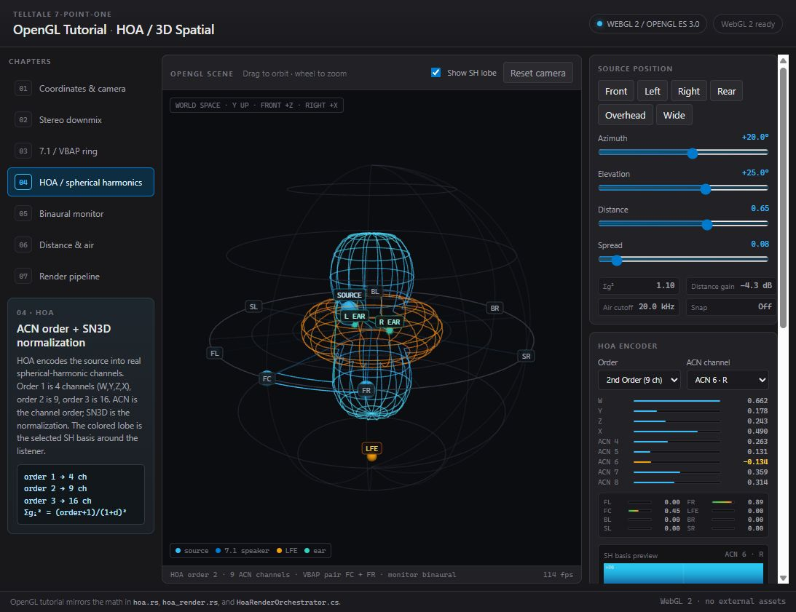

# OpenGL Tutorial · HOA / 3D Spatial

> **EXPERIMENTAL / BETA:** This tutorial is part of the experimental TellTale-Seven-Point-One project. The visualizer and audition are teaching tools; they are not a calibrated monitoring or mastering reference.

A self-contained WebGL 2 (OpenGL ES 3.0) explainer for the HOA / 3D Spatial workspace in **TellTale-Seven-Point-One**. It shows the actual math used by the Rust core and lets you move a source, change the encoder order, switch monitor modes, and hear a small audition signal.

The tutorial is a teaching tool only. It never loads the extension, never edits a VEGAS project, and never routes audio through the `[7.1] FL..SR` buses.



## Run it

Open `index.html` directly in a WebGL 2-capable browser:

```powershell
start tutorials\opengl_hoa\index.html
```

There is no build step, server, package install, or network access. The top-right pill reports the live GL version; hover it to see the renderer name. If WebGL is unavailable, the scene footer says so instead of drawing.

## Chapters

| # | Chapter | What it demonstrates |
| :-- | :--- | :--- |
| 01 | Coordinates & camera | Listener at the origin; azimuth, elevation and normalized distance; orbit/zoom camera |
| 02 | Stereo downmix | W/Y pan plus X front/back gain; equal-power cos/sin pair |
| 03 | 7.1 / VBAP ring | Seven-satellite ring, adjacent-pair search, 2×2 inversion, power normalization |
| 04 | HOA / spherical harmonics | ACN order, SN3D weights, 4/9/16 channels, per-channel SH balloon and heatmap |
| 05 | Binaural monitor | ITD, ILD/head shadow, rear darkening, elevation tilt, ear guide lines |
| 06 | Distance & air | Inverse, inverse-square, linear and no-rolloff laws; one-pole air absorption |
| 07 | Render pipeline | Selected Track / Full Mix stem → encoder → AmbiX master or preview |

Use the chapter list on the left; the lesson card updates with the equations for that stage.

## Controls

- **Source position** — azimuth, elevation, distance and spread sliders; Front/Left/Right/Rear/Overhead/Wide presets.
- **Snap** — off, 1°, 5°, 15°, 45°; applies to azimuth and elevation.
- **HOA encoder** — order 1/2/3, ACN channel selector, live weights, VBAP speaker meters, SH heatmap.
- **Monitor** — binaural / stereo / bypass preview, four distance models, four head models, head width, air absorption, room amount and size.
- **Readouts** — Σg², distance gain, air cutoff, L/R meters, correlation and ITD.
- **Audition** — a 220 Hz saw through the distance, air and room models. Click **Play tone** once to satisfy the browser's audio-gesture rule.
- **Show SH lobe** — wireframe balloon for the selected ACN channel; chapter 04 enables it automatically and leaves it off elsewhere unless you turn it on.

The scene is interactive: drag to orbit, wheel to zoom, **Reset camera** to restore the default view.

## Mapping to production code

| Tutorial function | Production source |
| :--- | :--- |
| `direction()`, `worldPosition()` | `rust_core/src/hoa.rs::unit_vector` |
| `shValues()`, `hoaWeights()` | `rust_core/src/hoa.rs::fill_weights`, `apply_spread_and_distance` |
| `speakerGains()` | `rust_core/src/vbap.rs` (pair table, inverse, normalization) |
| `stereoGains()` | `rust_core/src/hoa_render.rs::decode_stereo` |
| `binauralGains()`, `monitorGains()` | `rust_core/src/hoa_render.rs::decode_binaural` |
| `distanceModelGain()` | `rust_core/src/hoa_render.rs::distance_model_factor` |
| `airCutoff()` | `rust_core/src/hoa_render.rs::apply_air_absorption` |
| Chapter 07 overlay | `vegas_panel/HoaRenderOrchestrator.cs`, `NativeBridge.cs` (`HoaRenderOptions`) |

## Fidelity notes

- **The renderer is a visualizer, not the native engine.** OpenGL draws the source, speaker ring, SH basis, ears and guides. The audition is built from WebAudio nodes so it can run in a browser.
- **Weights are exact for the supported orders.** `shValues()` implements the same real-SH terms and SN3D scaling as `hoa.rs`; spread and `1/(1+d)` distance attenuation follow `apply_spread_and_distance`.
- **The SH balloon is peak-normalized per channel.** This keeps higher-order lobes readable; the numeric weights shown in the panel are not normalized for display.
- **The room is a compact approximation.** The native preview uses delay taps plus damped feedback combs. The browser audition uses a synthetic stereo impulse response (three early reflections per channel plus a decaying noise tail) and reduces dry level by the same `0.35 · amount` factor.
- **VBAP is horizontal only.** The tutorial's 7.1 ring is 2D, matching `vbap.rs`; elevation affects the HOA encoder and the binaural monitor, not the ring gains.
- **No external assets.** All geometry, shaders, heatmaps and audio are generated at runtime. No fonts, images, or scripts are fetched.

## Verification

Checked in the in-app Chromium browser at desktop widths:

- WebGL 2 context created; scene renders at 100+ fps; no console errors.
- All seven chapters switch correctly; chapter 07 shows the pipeline overlay.
- Order 1/2/3 produce 4/9/16 weights and ACN options; the SH balloon and heatmap update per channel.
- Azimuth 0° lands on FC, +90° lands on SR, and −140° selects the BL/SL pair; speaker meters track the gains.
- Binaural/stereo/bypass, ITD/ILD/off head models, all distance models and the air cutoff readout change as expected.
- Audition starts (`AudioContext` running), the room IR is rebuilt when room size changes, and Stop releases the tone.
